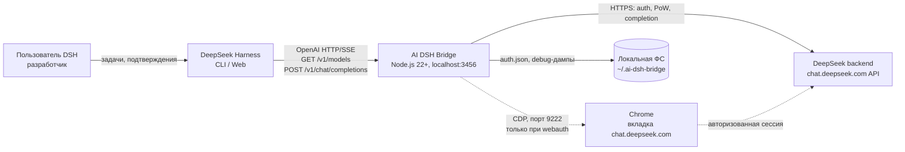
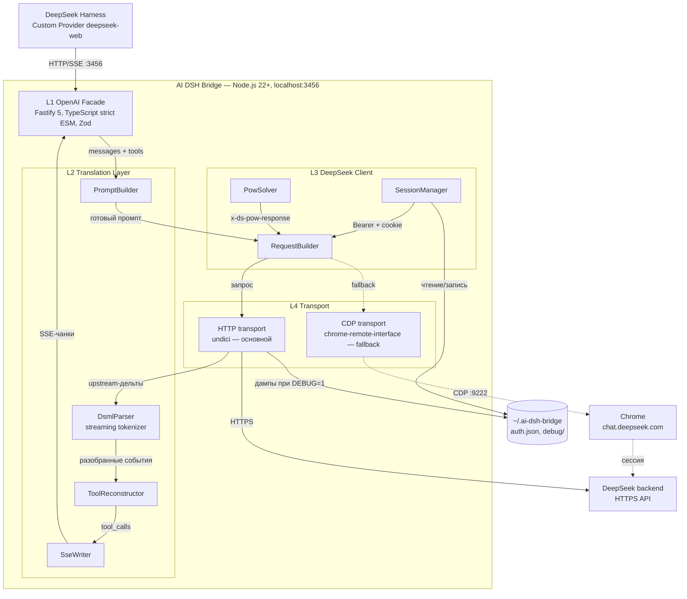
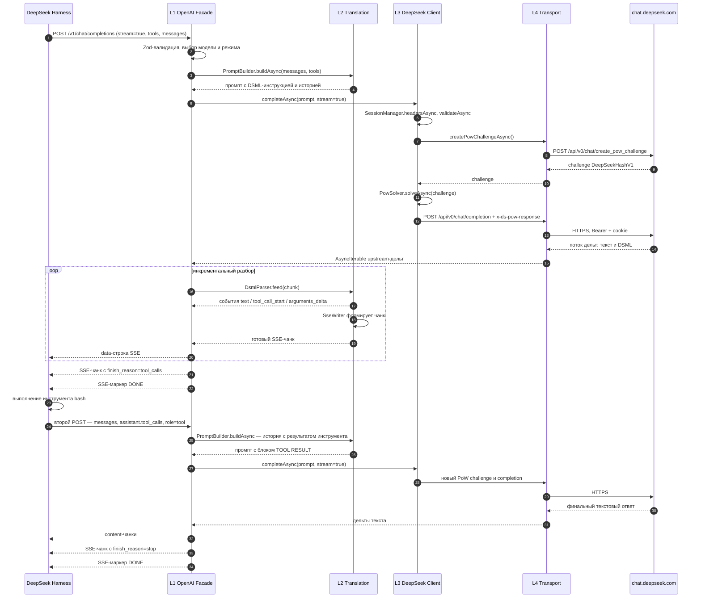
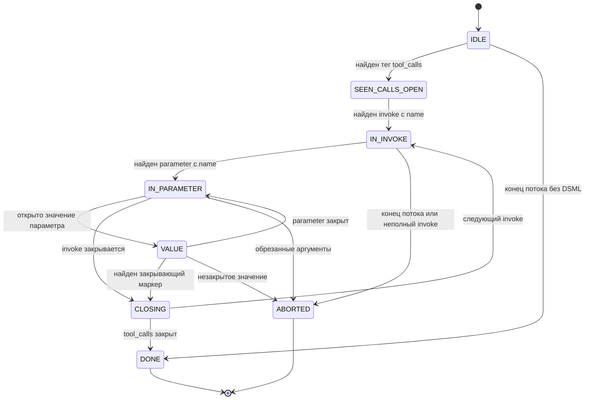

# AI DSH Bridge — архитектура (C4)

**Версия:** 0.1.0
**Дата:** 2026-10-19
**Статус:** целевая архитектура; в v0.1.0 реализован только каркас L1
**Связанные документы:** [DESIGN.md](./DESIGN.md), [api-contract.json](./api-contract.json), [GETTING_STARTED.md](./GETTING_STARTED.md)

> **Границы документа.** Это архитектурное описание **целевой** системы по
> модели C4. На этапе v0.1.0 в репозитории присутствуют документация и
> минимальный каркас L1 (Fastify, `GET /health`, `GET /v1/models`, заглушка
> `POST /v1/chat/completions`). Контейнеры L2–L4 и сквозной tool-call цикл
> реализуются на этапах 2–8 (см. DESIGN §10). Всё, что помечено как
> «целевое», является требованием к реализации, а не описанием уже
> работающего кода.

---

## 0. Легенда и структура документа

| Уровень C4 | Артефакт | Раздел |
|---|---|---|
| C4-1 | Системный контекст: акторы и внешние системы | §1 |
| C4-2 | Контейнеры: L1–L4, хранилище, протоколы | §2 |
| C4-3 | Компоненты слоя трансляции и клиента DeepSeek | §3 |
| Динамика | Сквозной сценарий `tool_calls` | §4 |
| Решения | Паттерны, контракты, ограничения, расширение | §5–§8 |

**Термины.**

- **DSH** — DeepSeek Harness, клиентское приложение, которое потребляет
  OpenAI-совместимый провайдер.
- **Шлюз (bridge)** — процесс AI DSH Bridge на `http://localhost:3456`.
- **DSML** — DeepSeek Markup Language, текстовый формат вызова инструментов,
  который генерирует веб-модель DeepSeek.
- **Upstream** — `chat.deepseek.com` и его внутренние эндпоинты
  (`/api/v0/...`), не являющиеся публичным API.

---

## 1. Системный контекст (C4 Level 1)

### 1.1. Назначение

AI DSH Bridge — локальный OpenAI-совместимый шлюз, который позволяет DSH
использовать веб-чат `chat.deepseek.com` как провайдера моделей. Пользователь
один раз авторизуется в браузере (`pnpm webauth`), после чего шлюз выполняет
запросы от имени этой сессии: решает Proof-of-Work, внедряет описания
инструментов в промпт, разбирает ответ DSML и отдаёт DSH корректный поток
OpenAI SSE, включая `tool_calls`.

Ключевое свойство системы: **снаружи шлюз выглядит как обычный
OpenAI-провайдер**, а внутри транслирует запросы в неофициальный веб-протокол
DeepSeek. Все нестабильности upstream изолированы внутри контейнеров L3–L4 и
слоя трансляции L2.

### 1.2. Диаграмма контекста



### 1.3. Акторы и внешние системы

| Актор / система | Тип | Назначение | Интерфейс |
|---|---|---|---|
| Пользователь DSH | Person | Ставит задачи, подтверждает выполнение инструментов | TUI/Web DSH |
| DeepSeek Harness (DSH) | Software system | Клиент-потребитель провайдера, исполняет инструменты (`bash`, чтение файлов) | OpenAI REST/SSE |
| AI DSH Bridge | Software system (в границах проекта) | Трансляция OpenAI ↔ веб-DeepSeek, эмуляция tool-call цикла | HTTP `:3456` |
| Chrome + `chat.deepseek.com` | External system | Источник авторизованной сессии; используется только в `webauth` | CDP `:9222`, HTTPS |
| DeepSeek backend | External system | Генерация ответов, PoW-challenge, валидация сессии | HTTPS `/api/v0/...` |
| Локальная ФС | Infrastructure | Хранение секретов (`auth.json`) и отладочных дампов (`debug/`) | Файлы вне репозитория |

### 1.4. Границы доверия

1. **L4 → upstream.** HTTPS-соединение с `chat.deepseek.com`; Bearer-токен и
   cookie сессии передаются только туда. Токен не попадает в DSH и не
   логируется.
2. **DSH → L1.** Локальный HTTP на `127.0.0.1`/`localhost`; API-ключ не
   проверяется (аутентификация уже «встроена» в сессию DeepSeek). Порт не
   должен публиковаться за пределы машины.
3. **FS.** `~/.ai-dsh-bridge/auth.json` содержит секреты и находится вне
   репозитория; `auth.json` и `.env` перечислены в `.gitignore`.
4. **Chrome.** CDP-порт `9222` открыт только на время `webauth`; в штатном
   режиме работы шлюз браузер не использует.
5. **Входящий трафик из интернета.** Отсутствует: шлюз не является публичным
   сервисом и не имеет CORS-политики для браузерных клиентов.

---

## 2. Контейнеры (C4 Level 2)

### 2.1. Состав контейнеров



### 2.2. Контейнеры и их интерфейсы

| Контейнер | Технология | Ответственность | Интерфейсы |
|---|---|---|---|
| **L1 OpenAI Facade** | Fastify 5, Zod, TypeScript 6 (strict ESM) | Валидация запросов, маршрутизация, оркестрация потока, SSE-ответ, коды ошибок | Вход: OpenAI REST/SSE; выход: `chat.completion`, `chat.completion.chunk` |
| **L2 Translation** | Чистый TypeScript, потоковые преобразователи | DSML-инъекция, потоковый разбор ответа, реконструкция `tool_calls`, формирование SSE-конверта | Вход: OpenAI `messages`/`tools`, upstream-дельты; выход: события парсера, чанки |
| **L3 DeepSeek Client** | TypeScript, `undici`, `chrome-remote-interface` | Сессия и её refresh, PoW-решение, сборка upstream-запроса | Вход: промпт и метаданные; выход: `AsyncIterable` дельт |
| **L4 Transport** | `undici` (primary), CDP (fallback) | Установка HTTPS/CDP-соединения, заголовки, таймауты, отмена | Вход: URL/заголовки/тело; выход: HTTP-поток |
| Хранилище конфигурации | JSON-файлы (`auth.json`, `.env`) | Секреты, локальные настройки, debug-дампы | ФС пользователя, вне репозитория |

### 2.3. Поток управления и данных

1. DSH вызывает `POST /v1/chat/completions` (streaming или non-streaming).
2. L1 валидирует тело (Zod), выбирает модель и режим (`stream`).
3. L2 строит единый промпт: системная DSML-инструкция, описания `tools`,
   история сообщений (включая предыдущие `tool_calls` и `role: "tool"`).
4. L3 проверяет сессию, решает PoW, собирает upstream-запрос.
5. L4 отправляет запрос и возвращает поток дельт.
6. L2 разбирает поток инкрементально и формирует чанки (текст либо
   `tool_calls` с особым правилом идентичности, §5.5).
7. DSH исполняет инструмент и присылает второй запрос с результатом
   (`role: "tool"`); цикл повторяется до финального ответа.

### 2.4. Ключевые архитектурные решения

| ADR | Решение | Альтернатива | Обоснование |
|---|---|---|---|
| ADR-001 | Прямой HTTP-транспорт (`undici`) — основной | Fetch внутри Chrome через CDP | Меньше движущихся частей, стабильнее и быстрее; при наличии Bearer, cookie и PoW прямой запрос подтверждён внешними реализациями (DESIGN §2.2) |
| ADR-002 | DSML вместо JSON-описания инструментов в промпте | Tools как обычный JSON в тексте промпта | Структурированные маркеры позволяют строить потоковый парсер; JSON-подход ненадёжен (DESIGN §5.1) |
| ADR-003 | `id`/`name` только в первом чанке `tool_calls` | Повторять идентичность в каждом чанке | DSH проверяет поля на `!== undefined`; пустые строки/`null` перезаписывают корректное значение и дают `UNKNOWN_TOOL` (DESIGN §5.3) |
| ADR-004 | `webauth` — одноразовый захват браузерной сессии | Официальный API-ключ | Публичного API с нужными моделями нет; ключи не требуются (DESIGN §1, §3) |
| ADR-005 | Один аккаунт, без балансировки | Пул аккаунтов | Снижает риск блокировок и сложность; вынесено за рамки первого этапа (DESIGN §1.2) |
| ADR-006 | Fail-safe при неполном DSML | Best-effort выполнение вызова | Неверный вызов инструмента опаснее явной ошибки (DESIGN §5.2, §8.2) |

---

## 3. Компоненты (C4 Level 3)

Сигнатуры методов ниже — **целевые**: они фиксируют контракт между слоями и
уточняются при реализации этапов 2–8. Внутренние имена и типы не являются
публичным API.

### 3.1. Сводная таблица компонентов

| Компонент | Слой | Ответственность | Ключевые методы |
|---|---|---|---|
| PromptBuilder | L2 | Превращает OpenAI-запрос в текст промпта DeepSeek с DSML-инструкцией | `buildAsync`, `renderToolsAsync`, `renderHistoryAsync` |
| DsmlParser | L2 | Инкрементальный разбор DSML из потока | `feed`, `flush` |
| ToolReconstructor | L2 | Сборка и валидация `tool_calls` из событий парсера | `apply`, `finalizeAsync` |
| SseWriter | L2 | Формирование OpenAI-совместимых SSE-чанков | `start`, `content`, `toolCallHeader`, `toolCallArguments`, `finish`, `end` |
| SessionManager | L3 | Загрузка, валидация и refresh сессии DeepSeek | `loadAsync`, `headersAsync`, `validateAsync`, `refreshAsync` |
| PowSolver | L3 | Решение challenge `DeepSeekHashV1` | `solveAsync` |
| RequestBuilder | L3 | Сборка upstream-запроса (сессия, промпт, файлы) | `buildAsync` |

### 3.2. PromptBuilder

**Ответственность.** Собирает детерминированный промпт: системную
DSML-инструкцию, каталог доступных инструментов и историю диалога. Не
выполняет сетевого I/O и не знает про транспорт.

**Входы:** `messages[]` OpenAI, `tools[]` (JSON Schema параметров),
`tool_choice`, служебные ограничения.
**Выходы:** строка/структура промпта для L3, включающая DSML-шаблон и
отрендеренную историю.

```ts
interface PromptBuilder {
  buildAsync(input: BuildPromptInput): Promise<BuiltPrompt>;
  renderToolsAsync(tools: OpenAITool[]): Promise<string>;
  renderHistoryAsync(messages: OpenAIMessage[]): Promise<string>;
}
```

**Правила отображения истории:**

- `assistant` с `tool_calls` → DSML-блок с теми же именами и аргументами.
- `tool` с результатом → текстовый блок `[TOOL RESULT: <tool_call_id>] ...`.
- `system`/`user` — как есть, с экранированием служебных маркеров.

**Режимы отказа.** Превышение лимита контекста → ошибка валидации с понятным
сообщением; неизвестная роль/структура сообщения → 400; инструмент без
валидной схемы → 400 (не отправлять upstream неоднозначный DSML-шаблон).

### 3.3. DsmlParser

**Ответственность.** Потоковый токенизатор: принимает произвольные
фрагменты upstream-текста, возвращает типизированные события. Не буферизует
весь ответ (кроме незавершённого маркера/значения), поэтому первый токен
уходит DSH без задержки на полный ответ.

**Входы:** фрагменты текста (`string`) в порядке поступления.
**Выходы:** события `text`, `tool_call_start`, `arguments_delta`,
`tool_call_end`, `error`.

```ts
type DsmlEvent =
  | { type: 'text'; text: string }
  | { type: 'tool_call_start'; index: number; name: string }
  | { type: 'arguments_delta'; index: number; fragment: string }
  | { type: 'tool_call_end'; index: number }
  | { type: 'error'; code: DsmlErrorCode; message: string };

interface DsmlParser {
  feed(chunk: string): DsmlEvent[];
  flush(): DsmlEvent[];
}
```

**Нормализация перед разбором.** Двойные pipe-маркеры
(`<｜｜DSML｜｜ ...>`), вариации пробелов и регистра структурных слов
приводятся к каноническим тегам. Незакрытый `invoke` на верхнем уровне
трактуется как неявный wrapper `tool_calls` (DESIGN §5.2).

**Режимы отказа.** Обрезанный параметр в конце потока — событие `error` и
запрет выполнения; маркеры DSML внутри значения параметра — отказ от вызова;
«мусорные» теги — пропуск с логированием, текст сохраняется как `content`.

### 3.4. ToolReconstructor

**Ответственность.** Накапливает события парсера в черновики вызовов,
генерирует стабильные `id` (один раз на вызов), собирает JSON аргументов и
валидирует его. Для non-streaming режима отдаёт готовый массив `tool_calls`.

**Входы:** поток `DsmlEvent`; выходы: `ToolCall[]` либо ошибка разбора.

```ts
interface ToolReconstructor {
  apply(event: DsmlEvent): ToolCallDraft | null;
  finalizeAsync(): Promise<ToolCall[]>;
}
```

**Режимы отказа.** Невалидный JSON аргументов → вызов не выполняется,
`finish_reason: "stop"` и текст ошибки в `content`; неизвестный инструмент →
вызов отдаётся как есть (DSH сам сформирует `UNKNOWN_TOOL` и обратную связь);
пустой `invoke` без параметров → пропускается; дублирующийся `index` → ошибка
контракта.

### 3.5. SseWriter

**Ответственность.** Единственное место, где формируется SSE-конверт
`chat.completion.chunk`. Инкапсулирует правило идентичности: `id` и `name`
передаются только в первом чанке `tool_calls` для данного `index`, в
continuation-чанках эти поля **отсутствуют** (не пустые и не `null`).

**Входы:** события `content`/`tool_call_*` от ToolReconstructor, идентификатор
запроса, модель. **Выходы:** SSE-строки `data: {...}` и финальный
`data: [DONE]`; ничего не буферизует сверх одного чанка.

```ts
interface SseWriter {
  start(): void;
  content(delta: string): void;
  toolCallHeader(index: number, id: string, name: string): void;
  toolCallArguments(index: number, fragment: string): void;
  finish(reason: 'stop' | 'tool_calls' | 'length' | 'error'): void;
  end(): void;
}
```

**Режимы отказа.** Разрыв соединения с DSH → отмена upstream-запроса
(AbortController); запись после `end()` → ошибка программиста; отсутствие
`finish_reason` перед `data: [DONE]` → ошибка контракта (тест должен
ловить); повторная отправка `id`/`name` → ошибка контракта.

### 3.6. SessionManager

**Ответственность.** Загружает `auth.json`, проверяет сессию через
`GET /api/v0/users/current`, при 401/403 пытается обновить токен из cookie,
формирует заголовки `Authorization: Bearer ...` и `Cookie` для upstream.

**Входы:** `auth.json` (путь из `AUTH_FILE`), ответы
`GET /api/v0/users/current`. **Выходы:** валидированные заголовки для
upstream-запроса; ошибки авторизации с категорией.

```ts
interface SessionManager {
  loadAsync(): Promise<void>;
  headersAsync(): Promise<Record<string, string>>;
  validateAsync(): Promise<boolean>;
  refreshAsync(): Promise<boolean>;
}
```

**Режимы отказа.** Файл отсутствует/невалиден → понятная ошибка с указанием
повторить `pnpm webauth`; refresh невозможен → 401 клиенту с сообщением
«Re-run webauth» (DESIGN §8.1); гонка refresh при параллельных запросах →
единый промис обновления (single-flight).

### 3.7. PowSolver

**Ответственность.** Получает challenge
(`POST /api/v0/chat/create_pow_challenge`), решает `DeepSeekHashV1`,
формирует base64-значение для заголовка `x-ds-pow-response`. Challenge
одноразовый и не кэшируется.

**Входы:** объект challenge от upstream (алгоритм `DeepSeekHashV1`,
сложность, данные challenge); **выходы:** base64-строка для заголовка;
ошибка решения.

```ts
interface PowSolver {
  solveAsync(challenge: PowChallenge): Promise<string>;
}
```

**Режимы отказа.** Ошибка решения/несовпадение алгоритма → до 3 попыток с
новым challenge; истёкший challenge (рассинхронизация часов) → повтор;
исчерпание попыток → 502 с диагностикой (без раскрытия токена).

### 3.8. RequestBuilder (вспомогательный)

**Ответственность.** Собирает тело upstream-запроса: идентификатор
`chat_session`, промпт, ссылки на файлы (на первом этапе не используются),
модель/режим рассуждения. Обеспечивает Zod-валидацию исходящих данных и
экранирование, чтобы исключить попадание секретов в тело/логи.

**Входы:** промпт, заголовки сессии, PoW-значение, выбранная модель.
**Выходы:** валидированный `POST /api/v0/chat/completion` (URL, headers,
body).

**Режимы отказа.** Несогласованная модель (`deepseek-web-*`) → 400 до
обращения к upstream; отсутствие сессии → 401; ошибка сериализации → 500 с
request id.

---

## 4. Динамический сценарий: полный цикл `tool_calls`

### 4.1. Диаграмма последовательности



### 4.2. Пошаговый разбор

1. **Запрос DSH.** `POST /v1/chat/completions`, `stream: true`, массив
   `tools` с JSON Schema, история `messages`.
2. **Валидация L1.** Zod проверяет форму; неизвестная модель → 400;
   `stream: false` включает non-streaming ветку.
3. **DSML-инъекция.** PromptBuilder добавляет системную инструкцию и
   каталог инструментов; история `assistant/tool` рендерится в DSML и
   `[TOOL RESULT: ...]` (DESIGN §6).
4. **Сессия.** SessionManager подставляет Bearer и cookie; при необходимости
   выполняет refresh.
5. **PoW.** L3 получает challenge и решает его; заголовок
   `x-ds-pow-response` обязателен для каждого completion-запроса.
6. **Upstream.** L4 отправляет запрос и получает поток дельт.
7. **Разбор.** DsmlParser нормализует маркеры и разбирает поток
   инкрементально; обычный текст немедленно становится `content`.
8. **Эмуляция вызова.** На `tool_call_start` SseWriter отправляет первый
   чанк `tool_calls` с `index`, `id`, `type: "function"`, `name` и пустыми
   `arguments`; далее — только фрагменты `arguments` (без `id`/`name`).
9. **Завершение.** Финальный чанк содержит `finish_reason: "tool_calls"`
   (или `"stop"`), затем `data: [DONE]`.
10. **Исполнение.** DSH собирает аргументы по `index`, выполняет `bash` и
    присылает второй запрос: `assistant` с `tool_calls` + `role: "tool"` с
    `tool_call_id`.
11. **Второй turn.** История снова рендерится в промпт (DSML + TOOL RESULT);
    upstream получает новый PoW-challenge и генерирует финальный ответ.
12. **Финал.** Текстовые чанки, `finish_reason: "stop"`, `data: [DONE]`;
    L1 фиксирует метрики и при `DEBUG=1` сохраняет дамп обмена.

### 4.3. Что критично в сценарии

- **Идентичность вызова.** `id` и `name` — один раз на `index`; иначе
  DSH получит `UNKNOWN_TOOL` и не сможет исполнить инструмент.
- **Порядок.** `tool_call_start` обязан предшествовать любым фрагментам
  аргументов; `tool_call_end` — предшествовать `finish_reason`.
- **Атомарность.** Если аргументы неполные/невалидные в конце потока,
  вызов **не выполняется**: `finish_reason: "stop"` и текст ошибки в
  `content` (fail-safe).
- **Идемпотентность.** Completion-запрос не идемпотентен; повтор после
  отправки первого токена запрещён (см. §5.4).
- **Второй turn.** Именно корректно отрендеренный `role: "tool"` позволяет
  модели связать результат с вызовом; без `tool_call_id` цикл рвётся.

---

## 5. Ключевые паттерны

### 5.1. DSML-инъекция

Инструменты DSH описываются в системной инструкции как DSML-шаблон, а не
как свободный текст. Это делает генерацию предсказуемой для потокового
парсера (DESIGN §5.1, §6.1):

```text
<｜DSML｜tool_calls>
  <｜DSML｜invoke name="bash">
    <｜DSML｜parameter name="command" string="true">ls -la</｜DSML｜parameter>
  </｜DSML｜invoke>
</｜DSML｜tool_calls>
```

Требования к реализации: канонические разделители `｜DSML｜`; явное указание
`string="true"` для строковых параметров; экранирование значений, чтобы
маркеры внутри аргумента не ломали разбор; детерминированный порядок
инструментов и параметров.

### 5.2. Потоковый токенизатор

Парсер не ждёт полного ответа: он читает фрагменты и «удерживает» только
незавершённый маркер или значение. Состояния:



Правила: текст вне DSML отдаётся сразу; неполный хвост буферизуется до
следующего чанка; на `flush()` состояние проверяется; переход в `ABORTED`
означает запрет выполнения вызова.

### 5.3. Fail-safe

| Ситуация | Поведение шлюза | Результат для DSH |
|---|---|---|
| Незакрытый параметр в конце потока | Вызов не выполняется | `finish_reason: "stop"`, текст ошибки в `content` |
| Неизвестный инструмент в DSML | `tool_calls` отдаются как есть | DSH формирует `UNKNOWN_TOOL` и передаёт модели обратную связь |
| Пустой `invoke` без параметров | Вызов игнорируется | Поток продолжается |
| DSML-маркеры внутри значения параметра | Отказ от выполнения вызова | Ошибка в `content`, без исполнения |
| Модель ответила обычным текстом | Текст отдаётся как `content` | Обычный ответ без `tool_calls` |
| Обрыв upstream до первого токена | Retry (см. §5.4) | Прозрачно для DSH |
| Обрыв upstream после первого токена | Ошибка потока | DSH получает ошибку, счётчик запроса в логах |

### 5.4. Retry и backoff

| Операция | Попытки | Условие повтора | Ограничение |
|---|---|---|---|
| `create_pow_challenge` | до 3 | Сетевой сбой, 5xx, истёкший/битый challenge | Новый challenge на каждую попытку |
| Решение PoW | до 3 | Несовпадение/ошибка решения | Без кэширования challenge |
| Валидация сессии / refresh | 1 + refresh | 401/403 от upstream | При неудаче — 401 клиенту с «Re-run webauth» |
| Completion (до первого токена) | до 2 | Сетевой сбой, 5xx | Экспоненциальная задержка с jitter |
| Completion (после первого токена) | 0 | — | Ошибка потока; повтор запрещён (не идемпотентно) |

Реализация: `AbortController` + таймауты на все внешние вызовы; отмена
upstream при разрыве соединения с DSH; логирование попыток без токенов и
полных промптов.

### 5.5. Правило «id/name только в первом чанке»

Нормативный контракт (DESIGN §5.3, docs/api-contract.json):

- Первый чанк для `index`: `id`, `type: "function"`, `function.name`,
  `function.arguments: ""`.
- Все последующие чанки: только `index` и `function.arguments` (фрагменты).
- Запрещено: `id: ""`, `name: null`, `name: ""` в continuation-чанках.
- `arguments` — всегда строка (JSON-фрагмент), даже если пустая.

```json
{"choices":[{"delta":{"tool_calls":[{"index":0,"id":"call_abc123","type":"function","function":{"name":"bash","arguments":""}}]}}]}
{"choices":[{"delta":{"tool_calls":[{"index":0,"function":{"arguments":"{\"command\":"}}]}}]}
{"choices":[{"delta":{"tool_calls":[{"index":0,"function":{"arguments":"\"ls -la\"}"}}]}}]}
{"choices":[{"delta":{},"finish_reason":"tool_calls"}]}
```

Причина: DSH проверяет поля на `!== undefined`. Пустая строка проходит
проверку и перезаписывает корректную идентичность вызова, после чего
исполнение инструмента невозможно.

### 5.6. Жизненный цикл сессии и PoW

- `webauth` выполняется один раз: браузер → cookie `ds_session_id` и Bearer
  токен → `~/.ai-dsh-bridge/auth.json`.
- Перед запросами сессия валидируется; при 401/403 — refresh из cookie, при
  неудаче — ошибка клиенту.
- PoW challenge запрашивается **на каждый** completion-запрос, время решения
  ~100–500 мс; challenge одноразовый.
- Токены и cookie не логируются и не передаются в DSH.

---

## 6. Контракты

### 6.1. Источники истины

- [DESIGN.md](./DESIGN.md) — назначение, слои, DSML и SSE-правило (§5),
  этапы реализации.
- [api-contract.json](./api-contract.json) — нормативный перечень полей
  OpenAI-объектов и SSE-чанков.
- [GETTING_STARTED.md](./GETTING_STARTED.md) — пользовательские шаги и
  troubleshooting.

Изменение контракта требует синхронного обновления `api-contract.json`,
этого документа и контрактных тестов.

### 6.2. HTTP-эндпоинты

| Метод | Путь | Назначение | Ответ | Доступность |
|---|---|---|---|---|
| GET | `/health` | Проверка живости процесса | `{"status":"ok","version":"0.1.0","uptime_sec":N}` | каркас v0.1.0 |
| GET | `/v1/models` | Список моделей для DSH | `ModelsResponse` | каркас v0.1.0 |
| POST | `/v1/chat/completions` | Основной эндпоинт (streaming / non-streaming) | SSE `chat.completion.chunk` или `chat.completion` | заглушка `501 Not implemented` в v0.1.0; реализация — этапы 3–7 |

`POST /v1/chat/completions` в каркасе возвращает ошибку в
OpenAI-совместимом конверте (`type: "not_implemented"`, `code:
"not_implemented"`); после этапов 3–7 — поток `chat.completion.chunk` либо
объект `chat.completion`. `/health` — служебный эндпоинт шлюза; в
`api-contract.json` он не входит (контракт описывает только
OpenAI-совместимую поверхность).

Базовый адрес по умолчанию — `http://localhost:3456` (переопределяется
`PORT`). DSH получает **полный URL** эндпоинта
`http://localhost:3456/v1/chat/completions`, а не префикс `/v1` (DESIGN §7.2).

### 6.3. Нормативные поля ответов

Согласно `api-contract.json`:

| Объект | Поля |
|---|---|
| `ChatCompletionResponse` | `choices`, `created`, `id`, `model`, `object`, `usage` |
| `Choice` | `finish_reason`, `index`, `message` |
| `Message` | `content`, `role`, `tool_calls` |
| `ToolCall` | `function`, `id`, `type` |
| `Function` | `arguments`, `name` |
| `Usage` | `completion_tokens`, `prompt_tokens`, `total_tokens` |
| `ModelsResponse` | `data`, `object` |
| `Model` | `created`, `id`, `object`, `owned_by` |

Идентификаторы моделей: `deepseek-web-chat` (диалоговая) и
`deepseek-web-reasoner` (режим рассуждений). Значения `created`/`owned_by`
не несут семантической нагрузки; ключевым является `id`.

### 6.4. SSE-формат (`chat.completion.chunk`)

Нормативные поля конверта: `choices`, `created`, `id`, `model`, `object`.
Поля `delta`: `content`, `role`, `tool_calls`.
Поля элемента `tool_calls`: `function`, `id`, `index`, `type`.
Поля `function` в дельте: `arguments`, `name`.

Пример текстового потока:

```text
data: {"id":"chatcmpl-7f3a","object":"chat.completion.chunk","created":1760886000,"model":"deepseek-web-chat","choices":[{"index":0,"delta":{"role":"assistant","content":"Запускаю "}}]}

data: {"id":"chatcmpl-7f3a","object":"chat.completion.chunk","created":1760886000,"model":"deepseek-web-chat","choices":[{"index":0,"delta":{"content":"команду."}}]}

data: {"id":"chatcmpl-7f3a","object":"chat.completion.chunk","created":1760886000,"model":"deepseek-web-chat","choices":[{"index":0,"delta":{},"finish_reason":"stop"}]}

data: [DONE]
```

Правила потока:

1. Первый содержательный чанк содержит `delta.role: "assistant"`.
2. Порядок `tool_call_start` → фрагменты `arguments` → `finish_reason`
   обязателен; `data: [DONE]` — последняя строка.
3. `finish_reason` принимает `stop`, `tool_calls`, `length`, `error`.
4. `Content-Type: text/event-stream; charset=utf-8`, разделитель — пустая
   строка между событиями.

### 6.5. Non-streaming ответ

```json
{
  "id": "chatcmpl-7f3a",
  "object": "chat.completion",
  "created": 1760886000,
  "model": "deepseek-web-chat",
  "choices": [{
    "index": 0,
    "message": {
      "role": "assistant",
      "content": null,
      "tool_calls": [{
        "id": "call_abc123",
        "type": "function",
        "function": { "name": "bash", "arguments": "{\"command\":\"ls -la\"}" }
      }]
    },
    "finish_reason": "tool_calls"
  }],
  "usage": { "prompt_tokens": 0, "completion_tokens": 0, "total_tokens": 0 }
}
```

`usage` заполняется оценкой; upstream-веб-протокол не гарантирует точные
значения токенов, поэтому нули допустимы как «неизвестно».

### 6.6. Ошибки

Целевой формат — OpenAI-совместимый объект ошибки; HTTP-код отражает
категорию:

```json
{"error":{"message":"DeepSeek session expired. Re-run webauth.","type":"upstream_auth_error","param":null,"code":"session_expired"}}
```

| Код | Когда | Сообщение |
|---|---|---|
| 400 | Невалидное тело, неизвестная модель/инструмент | Описание нарушения схемы |
| 401 | Сессия DeepSeek недействительна | «Re-run webauth» |
| 502 | Ошибка upstream/PoW после retry | Диагностика без секретов |
| 500 | Внутренняя ошибка | `request id` для корреляции |

### 6.7. Совместимость с DSH

- Провайдер настраивается как custom: `openaiURL` — полный URL
  `http://localhost:3456/v1/chat/completions`.
- API-ключ не проверяется; DSH требует непустую строку (например,
  `sk-dummy`).
- DSH может запросить `GET /v1/models` («Fetch available models») — список
  должен содержать оба идентификатора.
- Стриминг обязателен для полноценного tool-call цикла; non-streaming
  поддерживается как упрощённый режим.
- Таймауты: PoW добавляет 100–500 мс на запрос; клиентский таймаут DSH
  должен это учитывать.

---

## 7. Известные ограничения

| Ограничение | Причина | Влияние | Смягчение |
|---|---|---|---|
| Зависимость от неофициального API | `chat.deepseek.com` не является публичным API | Поломка при изменении эндпоинтов/вёрстки | Абстракция L3–L4, быстрый патч, `capture.http` |
| PoW `DeepSeekHashV1` | Одноразовый challenge, WASM-порт | Задержка 100–500 мс; риск устаревания алгоритма | Изоляция в PowSolver, обновление модуля |
| Нестабильный DSML | Модель может нарушать формат | Пропуск/неверный разбор вызова | Многоуровневый парсер, fail-safe, дампы |
| Только один аккаунт | Нет мультиаккаунтности | Rate limit, риск блокировки | Отдельный аккаунт, предупреждение в документации (GETTING_STARTED §10) |
| Нет гарантии потоковости инструментов | Аргументы приходят произвольными фрагментами | DSH обязан собирать по `index` | Контракт «id/name один раз», тесты |
| Нет параллельных вызовов | Целевой объём — один вызов за turn | Ограничение сценариев | Расширение в §8.4 |
| `usage` неточен | Веб-протокол не отдаёт токены | Метрики/стоимость условны | Оценка, явные нули |
| Нет вложений/файлов | `ref_file_ids` не используются на первом этапе | Нет работы с файлами upstream | Расширение L3 |
| `webauth` требует браузера | Ручной вход, CDP | Непригодно для headless/CI | Одноразовость, документация |
| Латентность выше официального API | PoW + лишний turn | Медленнее, чем прямой API | Кэширование upstream-ответа не применимо; оптимизация парсера |

Дополнительно: использование веб-интерфейса в обход официального API может
нарушать условия использования DeepSeek; проект не гарантирует стабильность
аккаунта. Рекомендуется отдельный аккаунт (DESIGN §11).

---

## 8. Точки расширения

| Точка | Интерфейс / расположение | Что сделать | Риск |
|---|---|---|---|
| Новый провайдер | Контракт L3 `completeAsync`/`streamAsync`, `src/deepseek/` | Реализовать клиент, добавить модели в `/v1/models` | Дублирование трансляции при ином формате |
| CDP как основной транспорт | `src/transport/cdp.ts`, интерфейс транспорта | Перенести выполнение запроса в контекст страницы | Хрупкость селекторов/версий Chrome |
| Нормализатор DSML | `src/translate/dsml-parser.ts` | Вынести цепочку нормализаций в отдельный модуль с тестами | Ложные срабатывания на тексте |
| Параллельные `tool_calls` | `index`/`id` в ToolReconstructor и SseWriter | Поддержать несколько вызовов за turn | Совместимость с DSH и моделью |
| Мультиаккаунтность | SessionManager | Пул сессий, выбор по лимитам | Блокировки, сложность ротации |
| Наблюдаемость | L1/L3, `DEBUG_DIR` | Метрики задержек PoW/парсера, request id | Утечка секретов в логи (запрещено) |
| Контрактные тесты | `test/sse-tool-calls.test.ts` | Проверка полей чанков, запрет `id`/`name` в continuation | Регрессии без полного e2e |

### 8.1. Новый провайдер

Новый upstream подключается на уровне L3 и L4: реализуется интерфейс
клиента (стриминг + non-streaming), модели регистрируются в `/v1/models`.
Слой L2 остаётся общим, если новый провайдер тоже проходит через текстовый
формат вызова инструментов; иначе добавляется отдельный реконструктор.

### 8.2. CDP как основной транспорт

CDP-транспорт сохраняется как fallback на случай ужесточения
TLS-фингерпринтинга или требования JS-контекста (DESIGN §2.2). Переключение
не должно затрагивать L2: транспорт возвращает те же дельты.

### 8.3. Нормализатор DSML

Расширяемые правила: двойные pipe-маркеры, пропущенный wrapper, варианты
пробелов, экранирование. Каждое правило покрывается unit-тестами и не
должно менять обычный текст ответа.

### 8.4. Параллельные вызовы инструментов

Требует: генерации стабильных `id` для каждого `index`, независимых
аккумуляторов аргументов, корректного порядка `finish_reason` и проверки,
что DSH поддерживает параллельные `tool_calls`.

### 8.5. Наблюдаемость и тесты

- Метрики: длительность PoW, время до первого токена, число разобранных
  вызовов, коды ошибок, retry-счётчики.
- Логи: `request id`, модель, статус upstream, `finish_reason`, без промптов
  целиком и без токенов (DESIGN §11, RULES).
- Тесты: `test/dsml-parser.test.ts`, `test/sse-tool-calls.test.ts`,
  `test/e2e.test.ts` (мок upstream).

---

## 9. Связанные документы

- [DESIGN.md](./DESIGN.md) — проектное описание, DSML, этапы реализации.
- [api-contract.json](./api-contract.json) — нормативные поля API/SSE.
- [GETTING_STARTED.md](./GETTING_STARTED.md) — установка, настройка DSH,
  troubleshooting.
- [RULES.md](./RULES.md) — правила разработки и безопасности.
- [KNOWN_ISSUES.md](./KNOWN_ISSUES.md) — реестр известных проблем.
- [CHANGELOG.md](./CHANGELOG.md) — история версий.
